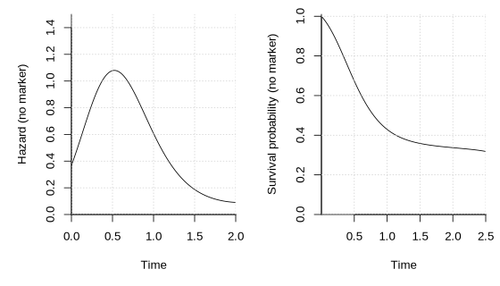
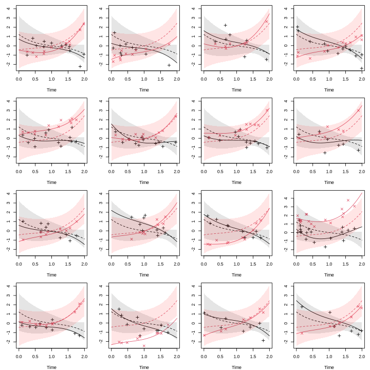
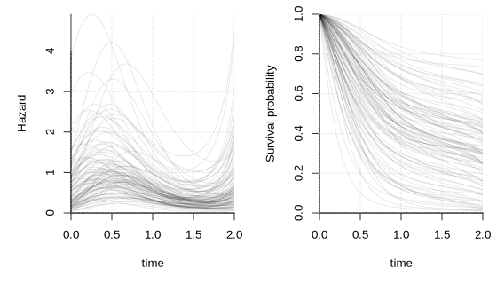
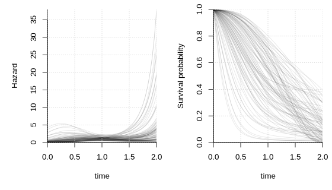
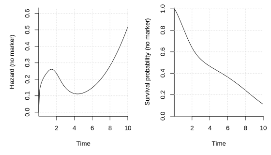
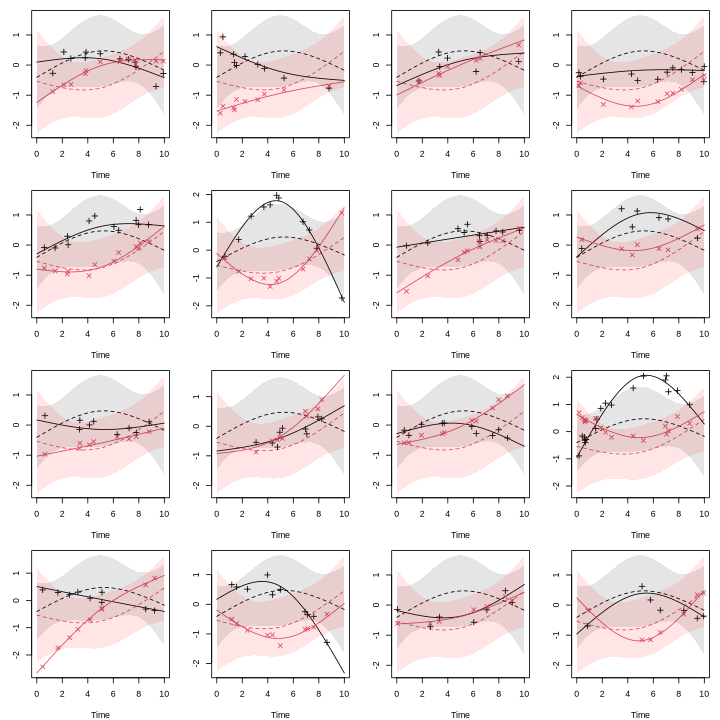
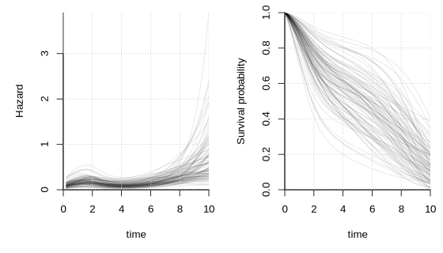

# SimSurvNMarker

[](https://github.com/boennecd/SimSurvNMarker/actions/workflows/R-CMD-check.yaml)
[](https://CRAN.R-project.org/package=SimSurvNMarker)
[](https://cranlogs.r-pkg.org/)

SimSurvNMarker simulates event times and repeated marker measurements
from a joint model. Use `sim_joint_data_set()` to specify time-dependent
basis functions, covariates, left-truncation times, and right-censoring
times in R.

## Installation

Use the `remotes` package to install the development version from
GitHub.

``` r
remotes::install_github(repo = "boennecd/SimSurvNMarker")
```

CRAN archived SimSurvNMarker on February 15, 2026. To install release
0.1.3 from the [CRAN
archive](https://cran.r-project.org/src/contrib/Archive/SimSurvNMarker/),
use:

``` r
remotes::install_version(package = "SimSurvNMarker", version = "0.1.3",
                         repos = "https://cloud.r-project.org")
```

## Joint model

At visit $j$, individual $i$ has a vector of $r$ marker measurements
$\vec Y_{ij}$ at time $s_{ij}$. The $K$ random effects $\vec U_i$ link
the marker trajectories to the event hazard.

$$\begin{aligned}
\vec Y_{ij} \mid \vec U_i = \vec u_i
  &\sim N^{(r)}(\vec\mu_i(s_{ij}, \vec u_i), \Sigma) \\
\vec\mu_i(s, \vec u)
  &= \Gamma^\top\vec x_i + B^\top\vec g(s) + U^\top\vec m(s) \\
  &= (I \otimes \vec x_i^\top)\mathrm{vec}(\Gamma) +
     (I \otimes \vec g(s)^\top)\mathrm{vec}(B) +
     (I \otimes \vec m(s)^\top)\vec u \\
\vec U_i &\sim N^{(K)}(\vec 0, \Psi)
\end{aligned}$$

Here $\vec u = \mathrm{vec}(U)$ stacks the columns of the random-effect
matrix $U$. The association parameters $\vec\alpha$ give the change in
log hazard per unit increase in each latent marker mean, with the other
means fixed.

$$\begin{aligned}
h(t \mid \vec u)
  &= \exp\left(\vec\omega^\top\vec b(t) + \vec z_i^\top\vec\delta
      + \vec\alpha^\top\vec\mu_i(t, \vec u)\right) \\
  &= \exp\Bigl(\vec\omega^\top\vec b(t) + \vec z_i^\top\vec\delta \\
  &\qquad + \vec 1^\top (\mathrm{diag}(\vec\alpha) \otimes \vec x_i^\top)\mathrm{vec}(\Gamma) \\
  &\qquad + \vec 1^\top (\mathrm{diag}(\vec\alpha) \otimes \vec g(t)^\top)\mathrm{vec}(B) \\
  &\qquad + \vec 1^\top (\mathrm{diag}(\vec\alpha) \otimes \vec m(t)^\top)\vec u\Bigr).
\end{aligned}$$

The vectors $\vec x_i$ and $\vec z_i$ contain known, time-invariant
covariates. The functions $\vec m(t)$, $\vec g(t)$, and $\vec b(t)$ can
use polynomials, B-splines, or natural cubic splines. A baseline log
hazard linear in $\log t$ gives a Weibull model when
$\vec\alpha = \vec 0$ and the slope exceeds $-1$. The package simulates
event times with Gauss–Legendre quadrature and one-dimensional root
finding, as described by Crowther and Lambert (2013).

## Examples

- [Use polynomial basis functions](#example-with-polynomials).
- [Use the marker slope in the hazard](#using-derivatives).
- [Use natural cubic splines](#example-with-natural-cubic-splines).

The [test data
directory](https://github.com/boennecd/SimSurvNMarker/tree/master/inst/test-data)
contains more examples. A [simulation
study](https://rpubs.com/boennecd/SimSurvNMarker-ex) compares estimates
with the parameters used to generate the data.

## Example with polynomials

Define the polynomial basis functions.

``` r
b_func <- function(x){
  x <- x - 1
  cbind(x^3, x^2, x)
}
g_func <- function(x){
  x <- x - 1
  cbind(x^3, x^2, x)
}
m_func <- function(x){
  x <- x - 1
  cbind(x^2, x, 1)
}
```

Use cubic polynomials for $\vec b$ and $\vec g$ and a quadratic
polynomial for the random term $U^\top\vec m(s)$.

``` r
library(package = "SimSurvNMarker")
```

``` r
omega <- c(1.4, -1.2, -2.1)
delta <- -.5 # the intercept

# quadrature nodes
gl_dat <- get_gl_rule(n = 30L)

# hazard function without marker
par(mar = c(5, 5, 1, 1), mfcol = c(1, 2))
plot(function(x) exp(drop(b_func(x) %*% omega) + delta),
     xlim = c(0, 2), ylim = c(0, 1.5), xlab = "Time",
     ylab = "Hazard (no marker)", xaxs = "i",  yaxs = "i", bty = "l")
grid()

# survival function without marker
plot(function(x) eval_surv_base_fun(ti = x, omega = omega, b_func = b_func, 
                                    gl_dat = gl_dat, delta = delta), 
     xlim = c(1e-4, 2.5),
     xlab = "Time", ylab = "Survival probability (no marker)", xaxs = "i",
     yaxs = "i", bty = "l", ylim = c(0, 1.01))
grid()
```



Simulate the marker measurements for 16 individuals. The dashed curves
show the population means $\vec\mu_i(s, \vec 0)$. The solid curves show
the individual means $\vec\mu_i(s, \vec U_i)$. Shading gives the
pointwise 95% intervals for individual means. Points show the observed
markers.

``` r
r_n_marker <- function(id)
  # one visit plus a Poisson draw
  rpois(1, 10) + 1L
r_obs_time <- function(id, n_markes)
  # draw observation times uniformly 
  sort(runif(n_markes, 0, 2))

Psi <- structure(c(0.18, 0.05, -0.05, 0.1, -0.02, 0.06, 0.05, 0.34, -0.25, 
                   -0.06, -0.03, 0.29, -0.05, -0.25, 0.24, 0.04, 0.04, 
                   -0.12, 0.1, -0.06, 0.04, 0.34, 0, -0.04, -0.02, -0.03, 
                   0.04, 0, 0.1, -0.08, 0.06, 0.29, -0.12, -0.04, -0.08, 
                   0.51), dim = c(6L, 6L))
B <- structure(c(-0.57, 0.17, -0.48, 0.58, 1, 0.86), dim = 3:2)
sig <- diag(c(.6, .3)^2)

# function to simulate a given number of individuals' markers' latent means
# and observed values
show_mark_mean <- function(B, Psi, sigma, m_func, g_func, ymax){
  tis <- seq(0, ymax, length.out = 100)
  Psi_chol <- chol(Psi)
  
  par_old <- par(no.readonly = TRUE)
  on.exit(par(par_old))
  par(mar = c(4, 3, 1, 1), mfcol = c(4, 4))
  
  sigma_chol <- chol(sigma)
  n_y <- NCOL(sigma_chol)
  for(i in 1:16){
    U <- draw_U(Psi_chol, n_y = n_y)
    y_non_rng <- t(eval_marker(tis, B = B, g_func = g_func, U = NULL, 
                               offset = NULL, m_func = m_func))
    y_rng     <- t(eval_marker(tis, B = B, g_func = g_func, U = U, 
                               offset = NULL, m_func = m_func))

    sds <- sapply(tis, function(ti){
      M <- (diag(n_y) %x% m_func(ti))
      G <- (diag(n_y) %x% g_func(ti))
      sds <- sqrt(diag(tcrossprod(M %*% Psi, M)))
      cbind(drop(G %*% c(B)) - 1.96 * sds,
            drop(G %*% c(B)) + 1.96 * sds)
    }, simplify = "array")
    lbs <- t(sds[, 1, ])
    ubs <- t(sds[, 2, ])

    y_obs <- sim_marker(B = B, U = U, sigma_chol = sigma_chol, 
                        m_func = m_func, r_n_marker = r_n_marker, 
                        r_obs_time = r_obs_time, g_func = g_func, 
                        offset = NULL)

    matplot(tis, y_non_rng, type = "l", lty = 2, ylab = "", xlab = "Time",
            ylim = range(y_non_rng, y_rng, lbs, ubs, y_obs$y_obs))
    matplot(tis, y_rng    , type = "l", lty = 1, add = TRUE)
    matplot(y_obs$obs_time, y_obs$y_obs, type = "p", add = TRUE, pch = 3:4)

    polygon(c(tis, rev(tis)), c(lbs[, 1], rev(ubs[, 1])), border = NA,
            col = rgb(0, 0, 0, .1))
    polygon(c(tis, rev(tis)), c(lbs[, 2], rev(ubs[, 2])), border = NA,
            col = rgb(1, 0, 0, .1))

  }
  invisible()
}
set.seed(1)
show_mark_mean(B = B, Psi = Psi, sigma = sig, m_func = m_func, 
               g_func = g_func, ymax = 2)
```



Set the association parameters and draw 100 sets of random effects. Plot
the conditional hazard and survival curves for each set.

``` r
alpha <- c(.5, .9)

# function to plot simulated conditional hazards and survival 
# functions
sim_surv_curves <- function(sig, Psi, delta, omega, alpha, B, m_func, 
                            g_func, b_func, ymax) {
  par_old <- par(no.readonly = TRUE)
  on.exit(par(par_old))
  par(mfcol = c(1, 2), mar = c(5, 5, 1, 1))

  # hazard functions
  tis <- seq(0, ymax, length.out = 50)
  n_y <- NCOL(sig)
  Us <- replicate(100, draw_U(chol(Psi), n_y = n_y), 
                  simplify = "array")

  hz <- apply(Us, 3L, function(U)
    vapply(tis, function(x)
      exp(drop(delta + b_func(x) %*% omega +
                 alpha %*% eval_marker(ti = x, B = B, m_func = m_func, 
                                       g_func = g_func, U = U, 
                                       offset = NULL))),
      FUN.VALUE = numeric(1L)))

  matplot(tis, hz, lty = 1, type = "l", 
          col = rgb(0, 0, 0, .1), xaxs = "i", bty = "l", yaxs = "i", 
          ylim = c(0, max(hz, na.rm = TRUE)), xlab = "time", 
          ylab = "Hazard")
  grid()

  # survival functions
  ys <- apply(Us, 3L, surv_func_joint,
              ti = tis, B = B, omega = omega, delta = delta,
              alpha = alpha, b_func = b_func, m_func = m_func, 
              gl_dat = gl_dat, g_func = g_func, offset = NULL)

  matplot(tis, ys, lty = 1, type = "l", col = rgb(0, 0, 0, .1),
          xaxs = "i", bty = "l", yaxs = "i", ylim = c(0, 1),
          xlab = "time", ylab = "Survival probability")
  grid()
}

set.seed(1)
sim_surv_curves(sig = sig, Psi = Psi, delta = delta, omega = omega, 
                alpha = alpha, B = B, m_func = m_func, g_func = g_func, 
                b_func = b_func, ymax = 2)
```



Define the covariates, fixed effects, and functions for left truncation
and right censoring.

``` r
r_z <- function(id)
  # returns a design matrix for a dummy setup
  cbind(1, (id %% 3) == 1, (id %% 3) == 2)
r_z(1:6) # covariates for the first six individuals
#>      [,1] [,2] [,3]
#> [1,]    1    1    0
#> [2,]    1    0    1
#> [3,]    1    0    0
#> [4,]    1    1    0
#> [5,]    1    0    1
#> [6,]    1    0    0

# same covariates for the fixed time-invariant effects for the marker
r_x <- r_z

r_left_trunc <- function(id)
  # no left-truncation
  0
r_right_cens <- function(id)
  # right-censoring time is exponentially distributed
  rexp(1, rate = .5)

# fixed effect coefficients in the hazard
delta_vec <- c(delta, -.5, .5)
# fixed time-invariant effect coefficients in the marker process 
gamma <- matrix(c(.25, .5, 0, -.4, 0, .3), 3, 2)
```

Simulate 1,000 individuals and measure the run time.

``` r
set.seed(70483614)
system.time(dat <- sim_joint_data_set(
  n_obs = 1000L, B = B, Psi = Psi, omega = omega, delta = delta_vec,
  alpha = alpha, sigma = sig, b_func = b_func, g_func = g_func,
  m_func = m_func, gl_dat = gl_dat, r_z = r_z, r_left_trunc = r_left_trunc, 
  r_right_cens = r_right_cens, r_n_marker = r_n_marker, 
  r_obs_time = r_obs_time, y_max = 2, gamma = gamma, r_x = r_x))
#>    user  system elapsed 
#>   0.408   0.000   0.408
```

Inspect the first survival records and marker measurements.

``` r
# survival data
head(dat$survival_data)
#>   Z1 Z2 Z3 left_trunc     y event id
#> 1  1  1  0          0 0.869  TRUE  1
#> 2  1  0  1          0 0.320  TRUE  2
#> 3  1  0  0          0 1.535  TRUE  3
#> 4  1  1  0          0 0.129  TRUE  4
#> 5  1  0  1          0 2.000 FALSE  5
#> 6  1  0  0          0 0.369 FALSE  6

# marker data
head(dat$marker_data, 10)
#>    obs_time    Y1      Y2 X1 X2 X3 id
#> 1    0.4392 1.984  0.8920  1  1  0  1
#> 2    0.6009 1.651  0.2385  1  1  0  1
#> 3    0.7747 0.819  0.1867  1  1  0  1
#> 4    0.0702 3.796 -0.5575  1  0  1  2
#> 5    0.1186 3.122  0.2074  1  0  1  2
#> 6    0.2737 2.977 -0.2365  1  0  1  2
#> 7    0.2829 2.506 -0.2323  1  0  1  2
#> 8    0.1121 2.211  0.1531  1  0  0  3
#> 9    0.3337 1.595  0.0196  1  0  0  3
#> 10   0.3430 0.294 -0.1353  1  0  0  3
```

Fit a linear mixed model to the simulated marker measurements.

``` r
library(package = "lme4")
#> Loading required package: Matrix

local({
  m_dat <- dat$marker_data
  n_y <- NCOL(gamma)
  d_x <- NROW(gamma)
  d_g <- NROW(B)
  d_m <- NROW(Psi) / n_y
  
  Y_names <- paste0("Y", 1:n_y)
  id_vars <- c("id", "obs_time")
  if(d_x > 0)
    id_vars <- c(id_vars, paste0("X", seq_len(d_x)))
  
  lme_dat <- reshape2::melt(data = m_dat, id.vars = id_vars, measure.vars = Y_names, 
                  variable.name = "XXTHEVARIABLEXX", 
                  value.name = "XXTHEVALUEXX")
  
  if(length(alpha) > 1){
    if(length(B) > 0L)
      frm <- substitute(
        XXTHEVALUEXX ~
          XXTHEVARIABLEXX : g_func(ti) - 1L +
          (XXTHEVARIABLEXX : m_func(ti) - 1L | i),
        list(ti = as.name("obs_time"), i = as.name("id")))
    else 
      frm <- substitute(
        XXTHEVALUEXX ~
          (XXTHEVARIABLEXX : m_func(ti, m_ks) - 1L | i),
        list(ti = as.name("obs_time"), i = as.name("id")))
    frm <- eval(frm)
    
    if(d_x > 0)
      for(i in rev(seq_len(d_x))){
        frm_call <- substitute(
          update(frm, . ~ XXTHEVARIABLEXX : x_var + .),
          list(x_var = as.name(paste0("X", i))))
        frm <- eval(frm_call)
      }
    
  } else {
    if(length(B) > 0L)
      frm <- substitute(
        XXTHEVALUEXX ~
          ns_func(ti, g_ks) - 1L +
          (ns_func(ti, m_ks) - 1L | i),
        list(ti = as.name("obs_time"), i = as.name("id"), 
             g_ks = as.name("g_ks"), m_ks = as.name("m_ks")))
    else 
      frm <- substitute(
        XXTHEVALUEXX ~
          (ns_func(ti, m_ks) - 1L | i),
        list(ti = as.name("obs_time"), i = as.name("id"), 
             m_ks = as.name("m_ks")))
    frm <- eval(frm)
    
    if(d_x > 0)
      for(i in rev(seq_len(d_x))){
        frm_call <- substitute(
          update(frm, . ~ x_var + .),
          list(x_var = as.name(paste0("X", i))))
        frm <- eval(frm_call)
      }
  }
        
  fit <- lmer(frm, lme_dat, control = lmerControl(
    check.conv.grad = .makeCC("ignore", tol = 1e-3, relTol = NULL)))
  
  gamma <- t(matrix(fixef(fit)[seq_len(d_x * n_y)], nr = n_y))
  
  B <- t(matrix(fixef(fit)[seq_len(d_g * n_y) + (d_x * n_y)], nr = n_y))
  vc <- VarCorr(fit)
  Psi <- vc$id
  attr(Psi, "correlation") <- attr(Psi, "stddev") <- NULL
  dimnames(Psi) <- NULL
  K <- SimSurvNMarker:::get_commutation(n_y, d_m)
  Psi <- tcrossprod(K %*% Psi, K)

  Sigma <- diag(attr(vc, "sc")^2, n_y)

  list(gamma = gamma, B = B, Psi = Psi, Sigma = Sigma)
})
#> $gamma
#>         [,1]      [,2]
#> [1,]  0.1684 -0.384105
#> [2,]  0.5224  0.000601
#> [3,] -0.0767  0.219846
#> 
#> $B
#>        [,1]  [,2]
#> [1,] -0.569 0.484
#> [2,]  0.282 0.988
#> [3,] -0.466 0.893
#> 
#> $Psi
#>         [,1]    [,2]    [,3]     [,4]     [,5]    [,6]
#> [1,]  0.5246  0.0687 -0.1609  0.12020 -0.02855  0.1125
#> [2,]  0.0687  0.3572 -0.2408 -0.03206 -0.04499  0.2571
#> [3,] -0.1609 -0.2408  0.2586 -0.00240  0.04644 -0.1342
#> [4,]  0.1202 -0.0321 -0.0024  0.16057 -0.00571  0.0470
#> [5,] -0.0285 -0.0450  0.0464 -0.00571  0.05336 -0.0832
#> [6,]  0.1125  0.2571 -0.1342  0.04705 -0.08325  0.4165
#> 
#> $Sigma
#>       [,1]  [,2]
#> [1,] 0.225 0.000
#> [2,] 0.000 0.225
```

Compare the estimates with the simulation parameters below. The fitted
model assumes equal residual variances for the two markers.

``` r
gamma
#>      [,1] [,2]
#> [1,] 0.25 -0.4
#> [2,] 0.50  0.0
#> [3,] 0.00  0.3
B
#>       [,1] [,2]
#> [1,] -0.57 0.58
#> [2,]  0.17 1.00
#> [3,] -0.48 0.86
Psi
#>       [,1]  [,2]  [,3]  [,4]  [,5]  [,6]
#> [1,]  0.18  0.05 -0.05  0.10 -0.02  0.06
#> [2,]  0.05  0.34 -0.25 -0.06 -0.03  0.29
#> [3,] -0.05 -0.25  0.24  0.04  0.04 -0.12
#> [4,]  0.10 -0.06  0.04  0.34  0.00 -0.04
#> [5,] -0.02 -0.03  0.04  0.00  0.10 -0.08
#> [6,]  0.06  0.29 -0.12 -0.04 -0.08  0.51
sig
#>      [,1] [,2]
#> [1,] 0.36 0.00
#> [2,] 0.00 0.09
```

Fit a Cox model with the most recent observed marker values. Measurement
error can bias the association estimates.

``` r
local({
  library(package = "survival")
  intervals <- tmerge(data1 = dat$survival_data, data2 = dat$survival_data,
                      id = id, tstart = left_trunc, tstop = y, ev = event(y, event))
  intervals <- tmerge(data1 = intervals, data2 = dat$marker_data, id = id,
                      Y1 = tdc(obs_time, Y1), Y2 = tdc(obs_time, Y2))
  fit <- coxph(formula = Surv(time = tstart, time2 = tstop, event = ev) ~
                 Z2 + Z3 + Y1 + Y2, data = intervals)
  print(summary(object = fit))
  invisible(fit)
})
#> Call:
#> coxph(formula = Surv(time = tstart, time2 = tstop, event = ev) ~ 
#>     Z2 + Z3 + Y1 + Y2, data = intervals)
#> 
#>   n= 4042, number of events= 535 
#>    (1000 observations deleted due to missingness)
#> 
#>       coef exp(coef) se(coef)     z Pr(>|z|)    
#> Z2 -0.5894    0.5546   0.1172 -5.03  5.0e-07 ***
#> Z3  0.2733    1.3143   0.1013  2.70    0.007 ** 
#> Y1  0.1900    1.2092   0.0445  4.27  1.9e-05 ***
#> Y2  0.5642    1.7580   0.0527 10.70  < 2e-16 ***
#> ---
#> Signif. codes:  0 '***' 0.001 '**' 0.01 '*' 0.05 '.' 0.1 ' ' 1
#> 
#>    exp(coef) exp(-coef) lower .95 upper .95
#> Z2     0.555      1.803     0.441     0.698
#> Z3     1.314      0.761     1.078     1.603
#> Y1     1.209      0.827     1.108     1.319
#> Y2     1.758      0.569     1.585     1.949
#> 
#> Concordance= 0.652  (se = 0.012 )
#> Likelihood ratio test= 171  on 4 df,   p=<2e-16
#> Wald test            = 162  on 4 df,   p=<2e-16
#> Score (logrank) test = 165  on 4 df,   p=<2e-16
```

The Cox baseline hazard absorbs the intercept. Compare the estimates for
Z2, Z3, Y1, and Y2 with their simulation coefficients.

``` r
delta_vec[-1]
#> [1] -0.5  0.5
alpha
#> [1] 0.5 0.9
```

### Using derivatives

Use the first derivative of the latent mean in the hazard. Plot the
resulting conditional hazard and survival curves.

``` r
g_func_surv <- function(x){
  x <- x - 1
  cbind(3 * x^2, 2 * x, 1)
}
m_func_surv <- function(x){
  x <- x - 1
  cbind(2 * x, 1, 0)
}

set.seed(1)
sim_surv_curves(sig = sig, Psi = Psi, delta = delta, omega = omega, 
                alpha = alpha, B = B, m_func = m_func_surv, 
                g_func = g_func_surv, b_func = b_func, ymax = 2)
```



Simulate a data set with the marker slopes in the hazard.

``` r
set.seed(70483614)
system.time(dat <- sim_joint_data_set(
  n_obs = 1000L, B = B, Psi = Psi, omega = omega, delta = delta_vec,
  alpha = alpha, sigma = sig, b_func = b_func, g_func = g_func,
  m_func = m_func, gl_dat = gl_dat, r_z = r_z, r_left_trunc = r_left_trunc, 
  r_right_cens = r_right_cens, r_n_marker = r_n_marker, 
  r_obs_time = r_obs_time, y_max = 2, gamma = gamma, r_x = r_x, 
  # the additions
  m_func_surv = m_func_surv, g_func_surv = g_func_surv, 
  use_fixed_latent = FALSE))
#>    user  system elapsed 
#>   0.454   0.023   0.478
```

Inspect the first survival records and marker measurements.

``` r
# survival data
head(dat$survival_data)
#>   Z1 Z2 Z3 left_trunc     y event id
#> 1  1  1  0          0 1.038 FALSE  1
#> 2  1  0  1          0 1.704  TRUE  2
#> 3  1  0  0          0 1.752  TRUE  3
#> 4  1  1  0          0 1.170  TRUE  4
#> 5  1  0  1          0 1.343  TRUE  5
#> 6  1  0  0          0 0.369 FALSE  6

# marker data
head(dat$marker_data, 10)
#>    obs_time    Y1     Y2 X1 X2 X3 id
#> 1    0.4392 1.984  0.892  1  1  0  1
#> 2    0.6009 1.651  0.239  1  1  0  1
#> 3    0.7747 0.819  0.187  1  1  0  1
#> 4    0.8931 0.853  0.521  1  1  0  1
#> 5    0.9442 1.522 -0.216  1  1  0  1
#> 6    0.0702 3.796 -0.558  1  0  1  2
#> 7    0.1186 3.122  0.207  1  0  1  2
#> 8    0.2737 2.977 -0.237  1  0  1  2
#> 9    0.2829 2.506 -0.232  1  0  1  2
#> 10   0.4253 2.098 -0.124  1  0  1  2
```

## Example with natural cubic splines

Define the spline knots, sampling functions, and model parameters.

``` r
# quadrature nodes
gl_dat <- get_gl_rule(n = 30L)

# knots for the spline functions
b_ks <- seq(log(1), log(10), length.out = 4)
m_ks <- seq(0, 10, length.out = 3)
g_ks <- m_ks

# simulation functions
r_n_marker <- function(id)
  rpois(1, 10) + 1L
r_obs_time <- function(id, n_markes)
  sort(runif(n_markes, 0, 10))
r_z <- function(id)
  as.numeric(runif(1L) > .5)
r_x <- function(id)
  numeric()
r_left_trunc <- function(id)
   rbeta(1, 1, 2) * 3
r_right_cens <- function(id)
  rbeta(1, 2, 1) * 6 + 4

# model parameters
omega <- c(-0.96, -2.26, -3.04, .45)
Psi <- structure(c(1.08, 0.12, -0.36, -0.48, 0.36, -0.12, 0.12, 0.36,
                   0, 0.12, 0, -0.12, -0.36, 0, 0.84, 0.12, 0.12, 0.12, -0.48, 0.12,
                   0.12, 0.84, -0.12, 0.24, 0.36, 0, 0.12, -0.12, 0.84, -0.12, -0.12,
                   -0.12, 0.12, 0.24, -0.12, 0.6), dim = c(6L, 6L))
B <- structure(c(0.97, 0.01, -0.07, -0.78, -0.86, 0.98), dim = 3:2)
sig <- diag(c(.2, .1)^2)
alpha <- c(0.7, 0.6)
delta <- 0.
gamma <- numeric()
```

``` r
# spline functions
b_func <- get_ns_spline(b_ks, do_log = TRUE)
m_func <- get_ns_spline(m_ks, do_log = FALSE)
g_func <- get_ns_spline(g_ks, do_log = FALSE)
```

Use `get_ns_spline()` to construct the spline bases. Plot the hazard and
survival functions without the marker contribution.

``` r
# hazard function without marker
par(mar = c(5, 5, 1, 1), mfcol = c(1, 2))
plot(function(x) exp(drop(b_func(x) %*% omega)),
     xlim = c(1e-8, 10), ylim = c(0, .61), xlab = "Time",
     ylab = "Hazard (no marker)", xaxs = "i", bty = "l")
grid()

# survival function without marker
plot(function(x) eval_surv_base_fun(ti = x, omega = omega, b_func = b_func, 
                                    gl_dat = gl_dat, delta = delta), 
     xlim = c(1e-4, 10),
     xlab = "Time", ylab = "Survival probability (no marker)", xaxs = "i",
     yaxs = "i", bty = "l", ylim = c(0, 1.01))
grid()
```



Simulate marker measurements. Each panel shows one individual.

``` r
set.seed(1)
show_mark_mean(B = B, Psi = Psi, sigma = sig, m_func = m_func, 
               g_func = g_func, ymax = 10)
```



Draw random effects and plot the corresponding conditional hazard and
survival curves.

``` r
set.seed(1)
sim_surv_curves(sig = sig, Psi = Psi, delta = delta, omega = omega, 
                alpha = alpha, B = B, m_func = m_func, g_func = g_func, 
                b_func = b_func, ymax = 10)
```



Simulate 1,000 individuals with the spline model.

``` r
set.seed(70483614)
delta_vec <- 1
system.time(dat <- sim_joint_data_set(
  n_obs = 1000L, B = B, Psi = Psi, omega = omega, delta = delta_vec,
  alpha = alpha, sigma = sig, b_func = b_func, g_func = g_func,
  m_func = m_func, gl_dat = gl_dat, r_z = r_z, r_left_trunc = r_left_trunc, 
  r_right_cens = r_right_cens, r_n_marker = r_n_marker, 
  r_obs_time = r_obs_time, y_max = 10, gamma = gamma, r_x = r_x))
#>    user  system elapsed 
#>   0.513   0.000   0.514
```

Inspect the first records and summarize the observed events and marker
counts.

``` r
# survival data
head(dat$survival_data)
#>   Z1 left_trunc    y event id
#> 1  0     0.3830 7.85 FALSE  1
#> 2  1     1.0779 2.10  TRUE  2
#> 3  0     0.8923 1.37  TRUE  3
#> 4  0     0.9055 8.04 FALSE  4
#> 5  1     0.8378 6.22  TRUE  5
#> 6  1     0.0649 1.84  TRUE  6

# marker data
head(dat$marker_data, 10)
#>    obs_time    Y1     Y2 id
#> 1      1.32 0.824 -2.165  1
#> 2      1.85 0.163 -2.132  1
#> 3      2.20 1.052 -1.914  1
#> 4      3.00 0.831 -1.941  1
#> 5      3.59 1.303 -1.840  1
#> 6      4.91 1.061 -1.660  1
#> 7      4.92 0.803 -1.770  1
#> 8      5.74 0.595 -1.520  1
#> 9      5.87 0.432 -1.364  1
#> 10     1.77 1.285 -0.497  2

# rate of observed events
mean(dat$survival_data$event) 
#> [1] 0.742

# mean event time
mean(subset(dat$survival_data, event           )$y)
#> [1] 3.49

# mean event time for the two group
mean(subset(dat$survival_data, event & Z1 == 1L)$y)
#> [1] 3.08
mean(subset(dat$survival_data, event & Z1 == 0L)$y)
#> [1] 4.16

# quantiles of the event time
quantile(subset(dat$survival_data, event)$y)
#>     0%    25%    50%    75%   100% 
#> 0.0707 1.6318 2.7531 5.2749 9.5271

# mean number of marker visits per individual
NROW(dat$marker_data) / NROW(dat$survival_data)
#> [1] 4.08
```

## References

<div id="refs" class="references csl-bib-body hanging-indent">

<div id="ref-Crowther13" class="csl-entry">

Crowther, Michael J., and Paul C. Lambert. 2013. “Simulating
Biologically Plausible Complex Survival Data.” *Statistics in Medicine*
32 (23): 4118–34. <https://doi.org/10.1002/sim.5823>.

</div>

</div>
